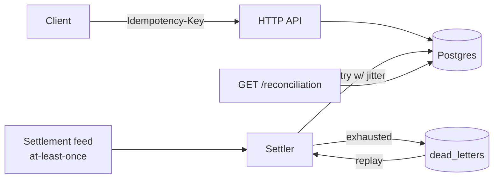

# Go Weekend Project: Signed, Append-Only Ledger

A small Go service you can actually run, separate from the .NET wallet plan. It shows the ledger patterns I've used in production: an append-only signed ledger, money as integer minor units, idempotency through a primary key, settlement that stays idempotent under at-least-once delivery, jittered retries, dead-letter recovery, and reconciliation that matches exactly.

---

## 1. Repo name

**Suggested:** `go-ledger` (github.com/tashen247/go-ledger)

**Alternatives:**
- `chainledger`: hints at the HMAC hash chain.
- `exact-ledger`: hints at reconciliation to the exact cent.

---

## 2. Project outline and directory layout

**Stack:** Go 1.22+ (the stdlib `net/http` router handles method and path patterns such as `POST /accounts/{id}`, so chi is optional), `pgx/v5` with `pgxpool`, Postgres 16 via docker-compose, `golang-migrate` for migrations, `log/slog`, and k6 for load tests.

```
go-ledger/
├── cmd/
│   ├── api/main.go            # HTTP server
│   └── settler/main.go        # settlement feed consumer + retry/DLQ worker
├── internal/
│   ├── money/                 # Amount (int64 minor units), currency checks
│   ├── ledger/                # posting, HMAC signing, hash chain, verify
│   ├── store/                 # pgx repositories, tx helpers (SERIALIZABLE retry)
│   ├── idempotency/           # key lookup/insert, request-hash check, stored response replay
│   ├── settlement/            # state machine, idempotent transitions
│   ├── retry/                 # exponential backoff + full jitter, max attempts
│   ├── deadletter/            # park, list, replay
│   ├── recon/                 # exact reconciliation queries
│   └── httpapi/               # handlers, errors (RFC 9457 problem+json), middleware
├── migrations/
│   ├── 0001_init.up.sql
│   └── 0001_init.down.sql
├── loadtest/
│   ├── transactions.js        # k6
│   └── idempotency_storm.js   # k6: same key, many concurrent requests
├── docs/
│   └── adr/                   # 0001-minor-units.md, 0002-idempotency-pk.md, 0003-hash-chain.md, ...
├── docker-compose.yml         # postgres + api + settler
├── Makefile                   # up, migrate, test, loadtest, verify-chain
├── .github/workflows/ci.yml   # go vet, staticcheck, tests against postgres service
└── README.md
```

**Key design points**
- **Money:** `type Amount int64` holds minor units (cents) and is paired with an ISO-4217 currency code. Nothing uses floats. JSON carries amounts as integers, and adding two amounts checks for overflow.
- **Ledger:** each transaction writes at least two `ledger_entries` whose signed amounts sum to zero within each currency. Each entry stores `prev_hash` and `hash = HMAC-SHA256(key, prev_hash || canonical(entry))`. A `verify-chain` command recomputes the whole chain and reports the first break. One global chain keeps it simple. Postings are serialized with `pg_advisory_xact_lock`, which is a known throughput trade-off and gets its own ADR.
- **Append-only:** a trigger rejects UPDATE, DELETE and TRUNCATE on `ledger_entries`. Corrections are made with reversing entries.
- **Idempotency:** `Idempotency-Key` is the primary key of `idempotency_keys`, and a SHA-256 hash of the request body is stored alongside it. When the same key arrives with the same body, the stored response is replayed. When it arrives with a different body, the API returns 422. A key whose original request is still in flight returns 409. The key row and the posting commit in the same DB transaction.
- **Settlement:** transitions are guarded by state (`UPDATE ... WHERE id=$1 AND state='pending'`). If the feed delivers the same event twice, the second delivery affects 0 rows and is acknowledged as a no-op. Settled is a terminal state.
- **Retry:** retries use exponential backoff with full jitter (`sleep = rand(0, min(cap, base*2^n))`) and only apply to transient errors (serialization failure 40001, deadlock 40P01, connection loss). After N attempts the message is parked in `dead_letters`.
- **Reconciliation:** each account's cached balance is compared with `SUM(ledger_entries.amount)`, each transaction is checked to net to zero, settlement totals are compared with their transaction rows, and the hash chain is verified. All of these are exact integer comparisons with no tolerance.

---

## 3. Core endpoints

### POST /accounts
```http
POST /accounts
Content-Type: application/json

{ "name": "alice-wallet", "currency": "ZAR", "type": "liability" }
```
```http
201 Created
{ "id": "acc_01J9Z...", "name": "alice-wallet", "currency": "ZAR", "type": "liability", "created_at": "2026-10-24T10:00:00Z" }
```

### POST /transactions (Idempotency-Key required)
```http
POST /transactions
Idempotency-Key: 7f9c2e1a-4b6d-4c1e-9a2f-1d3e5b7c9a01
Content-Type: application/json

{
  "reference": "deposit-123",
  "entries": [
    { "account_id": "acc_cash",  "amount": 15000 },
    { "account_id": "acc_alice", "amount": -15000 }
  ]
}
```
```http
201 Created
{
  "id": "txn_01J9Z...",
  "reference": "deposit-123",
  "currency": "ZAR",
  "entries": [
    { "seq": 1041, "account_id": "acc_cash",  "amount": 15000, "hash": "9c1e...a7" },
    { "seq": 1042, "account_id": "acc_alice", "amount": -15000, "hash": "4b0d...e2" }
  ],
  "created_at": "2026-10-24T10:00:01Z"
}
```
- If the same key arrives with the same body, the response is `201` with the identical body and an `Idempotent-Replayed: true` header.
- If the same key arrives with a different body, the response is `422 {"type":".../idempotency-key-reuse"}`.
- If entries don't net to zero, or the currencies are mixed, the response is `400`.
- Missing header: `400`.

### GET /accounts/{id}/balance
```http
200 OK
{ "account_id": "acc_alice", "currency": "ZAR", "balance": -15000, "as_of_seq": 1042 }
```

### POST /settlements
This endpoint receives an at-least-once feed event. The caller can send the same event any number of times.
```http
POST /settlements
Content-Type: application/json

{ "external_id": "psp-evt-8812", "transaction_id": "txn_01J9Z...", "status": "settled", "amount": 15000, "currency": "ZAR" }
```
```http
200 OK
{ "id": "stl_01J9Z...", "external_id": "psp-evt-8812", "state": "settled", "applied": true }
```
On a duplicate delivery the response is `200` with `"applied": false`. An illegal transition, such as settled → failed, returns `409`. A transient failure goes through the retry path and, once retries are exhausted, ends up in `dead_letters`.

### GET /reconciliation
```http
200 OK
{
  "ok": true,
  "checked_at": "2026-10-24T10:05:00Z",
  "accounts_checked": 3,
  "balance_mismatches": [],
  "unbalanced_transactions": [],
  "settlement_mismatches": [],
  "chain": { "verified_entries": 1042, "first_break_seq": null }
}
```

### POST /dead-letters/{id}/replay
```http
POST /dead-letters/dl_42/replay
```
```http
200 OK
{ "id": "dl_42", "status": "replayed", "result": { "settlement_id": "stl_01J9Z...", "applied": true } }
```
If the item was already replayed, the response is `200` with `"status":"replayed"` and the original result. Because settlement is idempotent by state, replaying the same item twice is safe. `GET /dead-letters?status=parked` lists the items that are parked.

---

## 4. Postgres DDL (migrations/0001_init.up.sql)

```sql
CREATE TABLE accounts (
  id          text PRIMARY KEY,
  name        text NOT NULL UNIQUE,
  currency    char(3) NOT NULL CHECK (currency ~ '^[A-Z]{3}$'),
  type        text NOT NULL CHECK (type IN ('asset','liability','equity','revenue','expense')),
  balance     bigint NOT NULL DEFAULT 0,        -- cache, reconciled against ledger_entries
  created_at  timestamptz NOT NULL DEFAULT now()
);

CREATE TABLE transactions (
  id          text PRIMARY KEY,
  reference   text NOT NULL,
  currency    char(3) NOT NULL,
  created_at  timestamptz NOT NULL DEFAULT now()
);

CREATE TABLE ledger_entries (
  seq             bigserial PRIMARY KEY,
  transaction_id  text NOT NULL REFERENCES transactions(id),
  account_id      text NOT NULL REFERENCES accounts(id),
  amount          bigint NOT NULL CHECK (amount <> 0),   -- minor units, signed
  currency        char(3) NOT NULL,
  prev_hash       bytea NOT NULL,
  hash            bytea NOT NULL UNIQUE,
  created_at      timestamptz NOT NULL DEFAULT now()
);
CREATE INDEX ON ledger_entries (account_id);
CREATE INDEX ON ledger_entries (transaction_id);

-- Append-only enforcement
CREATE FUNCTION forbid_ledger_mutation() RETURNS trigger LANGUAGE plpgsql AS $$
BEGIN
  RAISE EXCEPTION 'ledger_entries is append-only (% blocked)', TG_OP
    USING ERRCODE = 'insufficient_privilege';
END $$;

CREATE TRIGGER ledger_entries_no_update_delete
  BEFORE UPDATE OR DELETE ON ledger_entries
  FOR EACH ROW EXECUTE FUNCTION forbid_ledger_mutation();

CREATE TRIGGER ledger_entries_no_truncate
  BEFORE TRUNCATE ON ledger_entries
  FOR EACH STATEMENT EXECUTE FUNCTION forbid_ledger_mutation();

CREATE TABLE idempotency_keys (
  key             text PRIMARY KEY,                      -- the idempotency guarantee
  request_hash    bytea NOT NULL,
  status          text NOT NULL CHECK (status IN ('in_progress','completed')),
  response_code   int,
  response_body   jsonb,
  transaction_id  text REFERENCES transactions(id),
  created_at      timestamptz NOT NULL DEFAULT now()
);

CREATE TYPE settlement_state AS ENUM ('pending','settled','failed');

CREATE TABLE settlements (
  id              text PRIMARY KEY,
  external_id     text NOT NULL UNIQUE,                  -- dedup of feed events
  transaction_id  text NOT NULL REFERENCES transactions(id),
  amount          bigint NOT NULL CHECK (amount > 0),
  currency        char(3) NOT NULL,
  state           settlement_state NOT NULL DEFAULT 'pending',
  updated_at      timestamptz NOT NULL DEFAULT now(),
  created_at      timestamptz NOT NULL DEFAULT now()
);

-- Only legal transitions: pending -> settled | failed
CREATE FUNCTION check_settlement_transition() RETURNS trigger LANGUAGE plpgsql AS $$
BEGIN
  IF OLD.state = NEW.state THEN RETURN NEW; END IF;
  IF OLD.state = 'pending' AND NEW.state IN ('settled','failed') THEN
    NEW.updated_at := now(); RETURN NEW;
  END IF;
  RAISE EXCEPTION 'illegal settlement transition % -> %', OLD.state, NEW.state;
END $$;

CREATE TRIGGER settlements_state_machine
  BEFORE UPDATE ON settlements
  FOR EACH ROW EXECUTE FUNCTION check_settlement_transition();

CREATE TABLE dead_letters (
  id            text PRIMARY KEY,
  source        text NOT NULL,                 -- e.g. 'settlement_feed'
  payload       jsonb NOT NULL,
  last_error    text NOT NULL,
  attempts      int NOT NULL,
  status        text NOT NULL DEFAULT 'parked' CHECK (status IN ('parked','replayed')),
  replay_result jsonb,
  created_at    timestamptz NOT NULL DEFAULT now(),
  replayed_at   timestamptz
);
```

**Idempotent settlement apply (in one DB transaction):**
```sql
INSERT INTO settlements (id, external_id, transaction_id, amount, currency)
VALUES ($1,$2,$3,$4,$5)
ON CONFLICT (external_id) DO NOTHING;

UPDATE settlements SET state = $6
WHERE external_id = $2 AND state = 'pending';   -- 0 rows => already applied, no-op
```

**Reconciliation queries:**
```sql
-- cached balance vs ledger
SELECT a.id, a.balance, COALESCE(SUM(e.amount),0) AS ledger_sum
FROM accounts a LEFT JOIN ledger_entries e ON e.account_id = a.id
GROUP BY a.id HAVING a.balance <> COALESCE(SUM(e.amount),0);

-- every transaction nets to zero
SELECT transaction_id, SUM(amount) FROM ledger_entries
GROUP BY transaction_id HAVING SUM(amount) <> 0;

-- settled amount matches the transaction's positive leg
SELECT s.id FROM settlements s
JOIN ledger_entries e ON e.transaction_id = s.transaction_id AND e.amount > 0
WHERE s.state = 'settled'
GROUP BY s.id, s.amount HAVING s.amount <> SUM(e.amount);
```

---

## 5. Load test plan (k6) and weekend build plan

### Load test plan
| Scenario | Script | What it proves |
|---|---|---|
| Steady posting | `transactions.js`, ramping arrival rate (e.g. 50 → 500 req/s over 5 min), unique keys | Throughput and latency (p50/p95/p99) of a signed, chained posting |
| Idempotency storm | `idempotency_storm.js`: 200 VUs fire the same key at once | Exactly one transaction row is created; every other request gets a replay or a 409 |
| Duplicate settlement feed | Each event is sent 3× in shuffled order | Exactly one state change per `external_id` |
| Fault injection | Restart Postgres mid-run (`docker compose restart db`) | Retries recover, the rest land in dead_letters, and replay clears them |

**Thresholds:** `http_req_failed < 1%`. Set the p95 target once you have a baseline.

**Pass criteria after every run:** `GET /reconciliation` returns `ok: true`, `make verify-chain` reports no breaks, and `count(transactions)` equals the number of unique keys sent.

Record the machine specs, the Postgres config, and whether the API ran in Docker or on the host.

### Weekend build plan
**Friday evening (~2h): Phase 0, skeleton**
- `go mod init`, docker-compose with Postgres, migrations, Makefile, CI with a Postgres service.
- `money` package plus tests for overflow and currency mismatch.

**Saturday morning: Phase 1, ledger core**
- POST /accounts, POST /transactions with double-entry validation in a single DB transaction.
- HMAC hash chain under an advisory lock, plus the `verify-chain` command.
- An append-only trigger test that asserts UPDATE and DELETE fail.

**Saturday afternoon: Phase 2, idempotency and balances**
- Idempotency-Key table, request-hash check, replay, and the 409/422 cases.
- GET balance.
- A concurrency test: 50 goroutines using the same key produce exactly one transaction.

**Sunday morning: Phase 3, settlement, retry and DLQ**
- `cmd/settler` reads a JSONL feed file or HTTP input and applies events idempotently by state.
- `retry` package (full jitter, transient-error classifier) plus tests that use a fake clock and rand.
- dead_letters park, list and replay.

**Sunday afternoon: Phase 4, reconciliation, load and docs**
- GET /reconciliation.
- k6 scripts. Run them and fill in the README benchmark table.
- ADRs (minor units, PK idempotency, hash chain plus global lock, state-guarded settlement, full jitter).
- README polish and an architecture diagram (Mermaid).

**Stretch:** per-account chains for more parallelism, an outbox for events, OpenTelemetry, and testcontainers-go.

---

## 6. README.md (paste-ready)

````markdown
# go-ledger

A small, correctness-first ledger service in Go. I built it to show the patterns I rely on when money moves: an append-only, HMAC-signed double-entry ledger; amounts in integer minor units; idempotent writes keyed on a database primary key; settlement that stays correct under at-least-once delivery; jittered retries with dead-letter recovery; and reconciliation that has to match to the cent.

It's deliberately small enough to read in one sitting. The design follows patterns I've used in production ledger work. The code and numbers here belong to this repo alone.

## Why I built it

Ledger bugs rarely come from the happy path. They come from a client retrying after a timeout, a payment feed delivering the same event twice, or a database restart at the wrong moment. I wanted a compact project where each of those failure modes has an explicit answer, with a test or load scenario that proves it.

## Design



- **Money is an integer.** All amounts are `int64` minor units with an ISO-4217 currency. Floats never touch a balance.
- **Double-entry, append-only.** Every transaction writes entries that sum to zero. A Postgres trigger blocks UPDATE, DELETE and TRUNCATE on `ledger_entries`, so mistakes are corrected with reversing entries.
- **Tamper-evident.** Each entry is signed with `HMAC-SHA256(key, prev_hash || entry)`, forming a hash chain. `make verify-chain` recomputes it and points at the first broken link.
- **Idempotency through the primary key.** The `Idempotency-Key` header is the primary key of `idempotency_keys`, so the database enforces uniqueness rather than application code. A repeat with the same body replays the original response. A repeat with a different body is rejected.
- **Settlement is idempotent by state.** Transitions only fire `WHERE state = 'pending'`, so a duplicate event updates zero rows and is a safe no-op. A trigger enforces the legal transitions.
- **Retries with full jitter.** Only transient errors are retried (serialization failures, deadlocks, lost connections), using exponential backoff with full jitter. Once attempts are exhausted, the message is parked in `dead_letters` and can be replayed through the API.
- **Exact reconciliation.** Cached balances are checked against the sum of entries, every transaction must net to zero, settled amounts must match their transaction rows, and the chain must verify. There is no tolerance.

Design decisions and trade-offs (including the single global chain lock) are written up in [`docs/adr`](docs/adr).

## Run it

```bash
git clone https://github.com/tashen247/go-ledger
cd go-ledger
cp .env.example .env          # set LEDGER_HMAC_KEY
make up                       # postgres + api + settler via docker compose
make migrate
make test
```

Requires Docker and Go 1.22+.

## API

| Method | Path | Notes |
|---|---|---|
| POST | `/accounts` | Create an account (currency fixed per account) |
| POST | `/transactions` | Requires `Idempotency-Key`; entries must net to zero |
| GET | `/accounts/{id}/balance` | Balance in minor units |
| POST | `/settlements` | At-least-once feed input; duplicates are no-ops |
| GET | `/reconciliation` | Exact checks + chain verification |
| POST | `/dead-letters/{id}/replay` | Re-run a parked message |

```bash
curl -X POST localhost:8080/transactions \
  -H 'Idempotency-Key: 7f9c2e1a-4b6d-4c1e-9a2f-1d3e5b7c9a01' \
  -H 'Content-Type: application/json' \
  -d '{"reference":"deposit-123","entries":[
        {"account_id":"acc_cash","amount":15000},
        {"account_id":"acc_alice","amount":-15000}]}'
```

## Proving it

| Failure mode | How it's tested |
|---|---|
| Client retries after timeout | 200 concurrent requests with one key → exactly one transaction |
| Duplicate settlement events | Each event delivered 3× shuffled → one state change each |
| Someone edits history | UPDATE/DELETE on `ledger_entries` fails; chain verify catches direct tampering |
| DB restarts mid-load | Retries recover; leftovers land in `dead_letters`; replay clears them |
| Drift between cache and ledger | `GET /reconciliation` must return `ok: true` after every run |

## Benchmarks

Run with k6 (`make loadtest`). Results are from my machine and will vary.

| Scenario | Rate | p50 | p95 | p99 | Errors |
|---|---|---|---|---|---|
| Steady posting | _TBD_ req/s | _TBD_ ms | _TBD_ ms | _TBD_ ms | _TBD_ % |
| Idempotency storm (same key) | _TBD_ | _TBD_ | _TBD_ | _TBD_ | _TBD_ |
| Duplicate settlement feed | _TBD_ events/s | _TBD_ | _TBD_ | _TBD_ | _TBD_ |

Environment: _TBD (CPU / RAM / OS, Postgres version and config, API in Docker or on host)_
Post-run reconciliation: _TBD_ · Chain verification: _TBD_

## What I'd add for production

- Per-account hash chains, or batched signing, to remove the global posting lock.
- A transactional outbox for publishing ledger events.
- HMAC key rotation with a key ID stored on each entry.
- OpenTelemetry tracing and RED metrics.
- Partitioning `ledger_entries` by time, and archival.

## License

MIT
````
